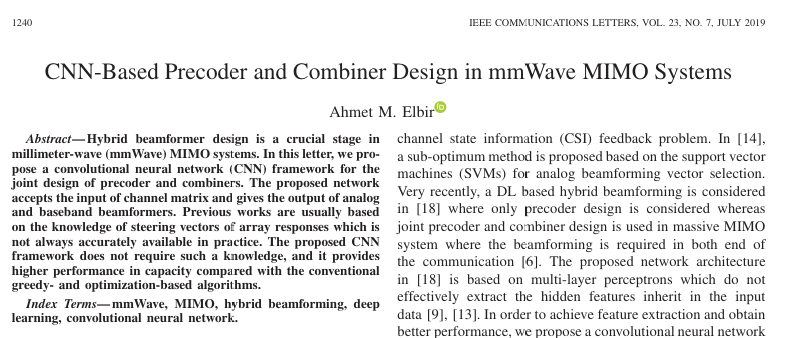
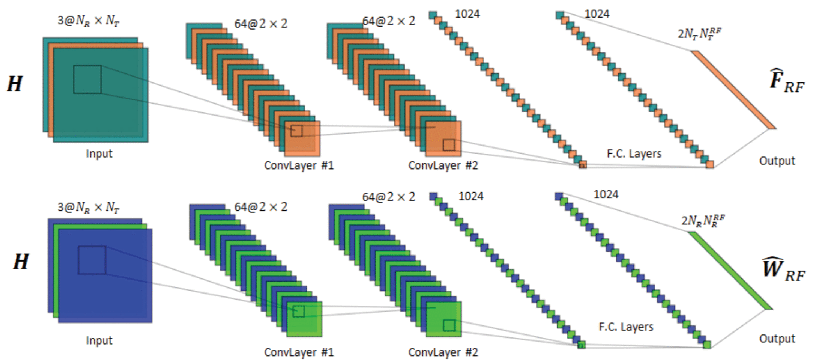
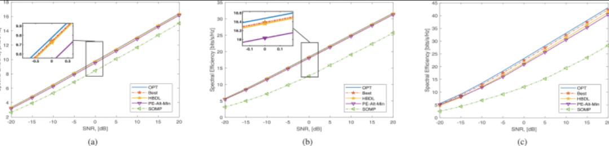

# MIMO - Precoding and combiner design based on CNN in mmWave MIMO systems [with MATLAB code]

The design of hybrid beamformers is a critical stage in millimeter wave (mmWave) MIMO systems. In this letter, we propose a convolutional neural network (CNN) framework for the joint design of pre-coders and combiners. The proposed network accepts input from the channel matrix and provides outputs for both the analog and baseband beamformers. Previous work typically relies on knowledge of steering vectors for array responses, which is not always accurate in practice. The proposed CNN framework does not require such knowledge and offers higher capacity performance compared to traditional greedy and optimization-based algorithms.
Introduction: Hybrid beamforming is a promising architecture that can be used in next-generation mmWave MIMO systems to provide strong beamforming performance at lower costs and fewer full-digital beamformers [1]–[4]. Several methods have been proposed for designing hybrid beamformers [3]–[7]. In [6], an approach based on greedy methods, namely Orthogonal Matching Pursuit (OMP), was proposed where the analog pre-coder and combiner are selected from dictionaries of transmitted and received array response. This algorithm requires knowledge of user arrival direction/aperture angles to construct such dictionaries. Leveraging the connection between the best beamformer and the hybrid beamformer, [7] proposed an alternating minimization method to estimate the analog and baseband beamformers based on phase extraction.
The above work provides solutions for the mixed beamforming problem based on optimization and greedy approaches. However, the main drawbacks of these techniques are achieving optimal solutions and computational time. To address this issue, we consider using deep learning (DL)-based techniques to solve the mixed beamforming problem [8]. DL has several advantages, such as low computational complexity when solving optimization or combination/greedy search problems, and the ability to infer new features from a limited feature set contained in the training dataset [9]. In the communication society, DL-based techniques have received widespread attention in channel estimation [10]–[12], DOA estimation [12], antenna selection [13], and analog beamforming selection [14]. In [15] and [16], end-to-end communication scenarios are modeled using autoencoders, considering single-input single-output (SISO) systems. [17] also uses autoencoders to address the channel state information (CSI) feedback problem. In [14], an SVM-based suboptimal method is proposed for analog beamforming vector selection. Recently, in [18], DL-based mixed beamforming is considered, where only precoding design is considered, while joint precoding and combiner design are used for large-scale MIMO systems where both ends of communication need beamforming [6]. The network architecture proposed in [18] is based on multilayer perceptrons, which cannot effectively extract inherited hidden features from the input data [9], [13]. To achieve feature extraction and obtain better performance, we propose a convolutional neural network (CNN) framework for millimeter wave large-scale MIMO systems.
In this study, we propose a CNN-based framework that includes two CNNs, each specifically designed to estimate the analog pre-coder and combiner. The CNNs accept input from the channel matrix and provide beamforming weights at the output. To train the network, we generate different channel realizations and add synthetic noise to each input data. We formulate and solve the decoupling optimization problem to obtain the best beamformer for maximum spectral efficiency. Using the best simulated beamformer, we construct the input-output pairs of the network. Since the best beamformer is the optimal solution to the problem, the proposed CNN framework offers better spectral efficiency and less computational time. Moreover, our CNN method does not require knowledge of the array response to user DOA/DOD angles, which are not always accurate in practical scenarios.
Illustration 
Conclusion In this work, we propose a CNN framework for joint estimation of the pre-coder and combiner in the mixed beamforming problem. We show that the proposed network architecture provides better spectral efficiency compared to optimized and greedy-based algorithms. In future work, we will retain training data with smaller sizes to develop similar transfer learning methods.

## Images

<!-- PAYMENT_BLOCK -->

## Get this dataset

- Payment link (Stripe): [Buy now](https://buy.stripe.com/3cs8yP7sY87d0vu9AB)
- Payment QR code: 

<!-- /PAYMENT_BLOCK -->
